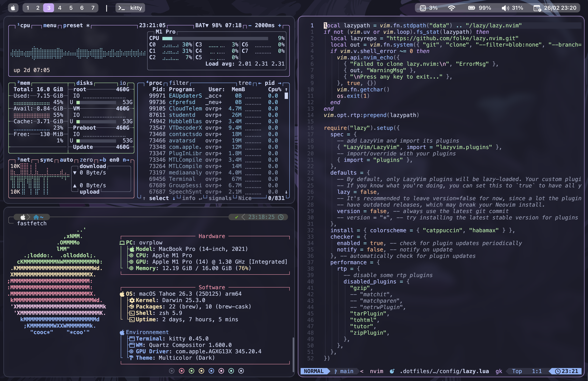

## My minimalist mac setup

Installation : 

```
git clone https://github.com/PierreWTH/dotfiles.git ~/.dotfiles
cd ~/.dotfiles
./install.sh
```

Not installed by the script : VMware Fusion (needed for `lab` / `labstop`), to download from Broadcom.




